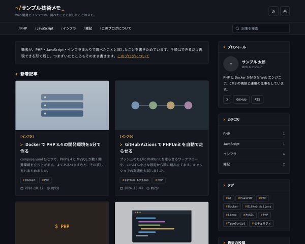

# BcBlogTechTerminalTheme

baserCMS5用の、エンジニアや Web 制作者の技術ブログのための、長い記事とコードを読みやすくすることを優先したブログテーマです。

スタイルは「ターミナル風（Terminal Dark）」。初期はダークで、地の色はサブ色（ほぼ黒）です。見出しの前に「#」「>」を付け、日付やタグは等幅フォントで見せます。ライトに切り替えると、白地に同じ骨格になります。



技術ブログテーマは3種類あります。仕組みと機能は同じで、見た目だけが違います。

| テーマ | 見た目 |
|---|---|
| BcBlogTechCleanTheme | すっきり：薄いグレーの地に、記事を白い紙のように浮かせる |
| BcBlogTechDenseTheme | タグ中心の密な一覧：行の形の一覧で、1画面に多くの記事が見える。タグを目立たせる |
| BcBlogTechTerminalTheme | ターミナル風：初期はダーク。見出しに「#」「>」、日付やタグは等幅フォント |

## 主な機能

- 記事の詳細
  - 目次：本文の h2・h3 から自動で作る。PC は右に固定、スマホは本文の上で開閉
  - 読了時間の目安（本文の文字数から計算）、投稿日・更新日、カテゴリ・タグ・書いた人
  - シェア（X・はてなブックマーク・Facebook・LINE・Feedly・RSS）、前後の記事、関連記事（同じタグの記事）、コメント
- 一覧：カード（アイキャッチ → 本文の最初の画像 → 「色の枠＋カテゴリ名」の順で表示）、番号つきのページ送り（スマホは1行に収まる形）
- ライト／ダークの切り替え（配色モードと切り替えボタンの有無は、テーマ設定で選べる）
- 本文：BurgerEditor のブロックでも、通常のエディタの HTML でも同じ見た目。コードブロック（等幅・横スクロール・コピーボタン・言語名）、表、引用、補足の囲み（「ポイント」「注意」）
- 広告の枠：ウィジェットエリア「広告：記事の上／記事の下／一覧の途中」（空のときは何も出ない）
- サイト内検索の結果画面、パンくず（構造化データつき）、印刷用の CSS（本文だけを印刷）
- テーマ設定の4色で配色を変えられる（どの色でも、文字が読める明るさに自動で調整する）
- jQuery に頼らない JS（BurgerEditor の公開側スクリプトとコメントの送信のために jQuery は読み込む）

## 動作環境

- baserCMS5.4以上
- BurgerEditor（BcBurgerEditor）：なくても使えます（通常のエディタで書いた本文にも対応）
- 対応ブラウザ：最新の Chrome・Edge・Safari・Firefox（CSS のコンテナクエリ・`:has()`・`color-mix()` を使っています）

## インストール

1. このリポジトリの Releases から ZIP をダウンロードし、管理画面の「テーマ管理」→「新しいテーマを追加」でアップロードする（または `plugins/BcBlogTechTerminalTheme/` に置く）
2. 「テーマ管理」で BcBlogTechTerminalTheme を適用する
3. 見本のデータを入れるときは、初期データ「default」を読み込む（空の状態から始めるときは「empty」、ページ送りなどを確かめるときは記事が40本入った「test」）

> 初期データを読み込むと、ユーザー以外のデータ（固定ページ・ブログ・ウィジェットなど）は初期化されます。運用中のサイトでは読み込まないでください。

## 使い方

### 編集できる場所

| 内容 | 編集する場所 |
|---|---|
| サイト名 | サイト管理 →「サイトタイトル」 |
| ヘッダーの説明1行・ブログのトップの紹介文 | ブログ設定 →「ブログ説明文」（ヘッダーには最初の1文が出る） |
| トップページの紹介文 | 固定ページ「index」の本文 |
| ヘッダー・フッターのナビ | 自動：最初のブログのカテゴリ（第1階層）＋ルート直下の固定ページ（「メニューに表示しない」を除く） |
| ロゴ・配色（4色）・配色モード・切り替えボタン | テーマ設定 |
| サイドバー | ウィジェットエリア「サイドバー」（プロフィール・カテゴリ・タグ・最近の投稿・月別アーカイブ） |
| 広告 | ウィジェットエリア「広告：記事の上」「広告：記事の下」「広告：一覧の途中」にテキストのウィジェットで広告のコードを貼る（「タイトルを表示」はオフ） |
| 記事の下の著者紹介 | ウィジェットエリア「記事の下：著者」のテキストのウィジェット |
| 一覧の件数・コメントの受け付け | ブログ設定 |

### 本文の書き方

- 見出しは h2・h3 を使う（目次に載る）。h4 は目次に載らない
- コード：BurgerEditor なら [BgeAddonSyntaxHighlight](https://github.com/kaburk/BgeAddonSyntaxHighlight)（色分け・行番号・コピー）が使える。通常のエディタでは `<pre><code class="language-php">…</code></pre>` と書くと、等幅の枠・言語名・コピーボタンがつく
- Markdown：BurgerEditor なら [BgeAddonMarkdown](https://github.com/kaburk/BgeAddonMarkdown) の本文も、同じ見た目になる
- 補足の囲み：引用（blockquote）の最初の段落を、太字だけの1行にする

```html
<blockquote><p><strong>ポイント</strong></p><p>本文…</p></blockquote>
```

## 設定

### 配色モード

テーマ設定の「配色モード」「ライト／ダークの切り替えボタン」で選べます。テーマ設定を保存していないときは、`config/setting.php` の `colorScheme`（`auto`／`light`／`dark`）と `schemeToggle`（`true`／`false`）が使われます。

- 切り替えボタンを表示するとき：閲覧者が選んだ配色が優先されます
- 切り替えボタンを表示しないとき：配色モードの配色に固定されます（「OS の設定に合わせる」なら OS に従います）

### 広告の枠を自分のサイトに足すとき

初期データを使わずにテーマだけを適用したときは、ウィジェットエリアを「広告：記事の上」「広告：記事の下」「広告：一覧の途中」「記事の下：著者」の名前で作ると、その場所に表示されます（名前で探しています）。

## 制限事項

- アイキャッチの見本画像は、初期データでは入りません（baserCMS の初期データは画像ファイルをコピーしないため）。見本の記事は、本文の最初の画像をカードに使っています
- 初期データを読み込むと、記事の投稿日は見本の日付に戻ります（BcBlog は読み込み時にすべての投稿日を「今」にするため、テーマで戻しています）
- サイト内検索の索引は、初期データに同梱しています。記事を追加・編集すると、索引は自動で更新されます

## 同梱物・外部リソース

| 名前 | 用途 | ライセンス |
|---|---|---|
| [jQuery](https://jquery.com/) 3.7.1（`webroot/js/vendor/`） | BurgerEditor の公開側スクリプトと、ブログのコメントの送信に必要 | MIT |
| [Google Fonts](https://fonts.google.com/)（Noto Sans JP・JetBrains Mono） | 本文・コードのフォント（CDN から読み込み。同梱はしていない） | SIL Open Font License 1.1 |
| アイコン（`templates/element/icons.php` の SVG） | ヘッダー・シェア・日付などのアイコン | このテーマの一部（MIT） |
| 見本画像（`webroot/img/sample/`） | 見本の記事の画像（文字を含まない図形） | このテーマの一部（MIT） |

## ライセンス

MIT License（[LICENSE](LICENSE)）
